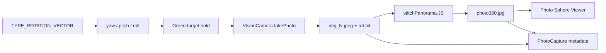

# LocalPhoto360 — Technical Document

Offline Android app for **guided multi-shot 360 capture**, **on-device stitching**, local storage, and **equirectangular 360 viewing**. No server, login, or cloud upload.

| Item | Value |
|------|-------|
| Application ID | `com.localphoto360` |
| Platform | Android (primary) |
| Project root | `LocalPhoto360/` |
| Source of capture UX | Ported from `360photos` |

---

## Table of contents

1. [Overview](#1-overview)
2. [Environment requirements](#2-environment-requirements)
3. [Tech stack](#3-tech-stack)
4. [Architecture & project structure](#4-architecture--project-structure)
5. [Capturing logic](#5-capturing-logic)
6. [Stitching logic](#6-stitching-logic)
7. [Data model & storage](#7-data-model--storage)
8. [360 viewer](#8-360-viewer)
9. [Build & run](#9-build--run)
10. [Known constraints](#10-known-constraints)

---

## 1. Overview

### End-to-end pipeline

```
Home → Guide → Capture
  → select max-FOV back camera (prefer ultra-wide)
  → build green-target grid from device FOV
  → user holds phone on each target (yaw / pitch / roll)
  → auto takePhoto → save img_<id>.jpeg + pose row
  → write rot.txt → stitchPanorama() → photo360.jpg
  → Home gallery / Detail / Photo Sphere Viewer
```



### What stitching is / is not

| Is | Is not |
|----|--------|
| Offline, on-device, pure JavaScript | OpenCV / native `Stitcher` |
| Pose + FOV projection onto equirectangular canvas | Feature matching / bundle adjustment |
| Center-weighted seam blending | Exposure compensation / seam finding |

---

## 2. Environment requirements

### 2.1 Development machine

| Item | Requirement |
|------|-------------|
| OS | Windows 10+ (documented), macOS/Linux possible for RN |
| Shell | PowerShell (Windows) |
| JDK | **17** (required by RN 0.72 / AGP — not 8 or 21 for this project) |
| Node.js | **≥ 16** (`package.json` engines); verified with v24 |
| npm | With `legacy-peer-deps=true` (see `.npmrc`) |
| Android Studio | SDK Platform **33**, Build-Tools **33.0.0**, NDK, CMake |
| Disk | Several GB free on `GRADLE_USER_HOME` (recommend short path `C:\g`) |

### 2.2 Android toolchain

| Item | Value |
|------|-------|
| Gradle wrapper | **8.0.1** |
| compileSdk / targetSdk | **33** |
| minSdk | **26** |
| NDK | **23.1.7779620** |
| CMake | **3.22.1** (VisionCamera native build) |
| Kotlin | **1.7.22** |
| Hermes | enabled |
| New Architecture | disabled |
| Release ABIs | `arm64-v8a`, `armeabi-v7a` |

### 2.3 Environment variables

```powershell
JAVA_HOME          = C:\Program Files\Java\jdk-17
ANDROID_HOME       = <Android SDK path>
ANDROID_SDK_ROOT   = <Android SDK path>
GRADLE_USER_HOME   = C:\g          # short path recommended on Windows
```

Optional when C: is low on space:

```powershell
TEMP = D:\tmp
TMP  = D:\tmp
```

### 2.4 Device requirements (runtime)

| Requirement | Why |
|-------------|-----|
| Physical Android phone | Emulator sensors/camera are unreliable for capture |
| Back camera | Capture uses rear camera only |
| Ultra-wide / high FOV preferred | Fewer shots needed; FOV > 90° → 25 targets |
| Accelerometer + compass / rotation vector | Guided aiming + pose for stitch |
| Permissions | `CAMERA`, storage, `HIGH_SAMPLING_RATE_SENSORS` |

### 2.5 Windows path workarounds

Long paths under folders like `D:\MY PREV WORK\...` can break Gradle / CMake / Ninja:

```powershell
$env:GRADLE_USER_HOME = "C:\g"
subst L: "D:\MY PREV WORK\BOSSSS\LocalPhoto360"
cd L:\android
.\gradlew.bat assembleRelease --no-parallel
```

More detail: see `ENVIRONMENT.md`.

---

## 3. Tech stack

### 3.1 Application layer

| Layer | Technology | Version / notes |
|-------|------------|-----------------|
| Framework | React Native | **0.72.4** |
| UI | React | **18.2.0** |
| Language | TypeScript | **4.8.4** |
| Navigation | React Navigation native stack | 6.x |
| Local DB | Realm + `@realm/react` | **12.3.0** |
| Camera | `react-native-vision-camera` | **3.6.3** |
| Worklets | `react-native-worklets-core` | peer of VisionCamera |
| Orientation | `react-native-orientation-angle` | GitHub fork; `TYPE_ROTATION_VECTOR` |
| Filesystem | `react-native-fs` | frames, `rot.txt`, panorama |
| Image resize | `@bam.tech/react-native-image-resizer` | stitch prep + thumbnails |
| SVG overlay | `react-native-svg` | green targets / guides |
| WebView | `react-native-webview` | 360 viewer |
| Import | `react-native-document-picker` | import existing `photo360.jpg` |
| Keep awake | `@sayem314/react-native-keep-awake` | during capture |
| Orientation lock | `react-native-orientation-locker` | capture UX |

### 3.2 Stitching stack (no OpenCV)

| Library | Role |
|---------|------|
| `jpeg-js` | Decode source frames / encode equirect JPEG |
| `buffer` | Binary buffers in RN JS |
| Image Resizer | Downscale frames (~640×480) before decode |
| Custom `stitchPanorama.ts` | Pose → ray → lon/lat → weighted accumulate |

### 3.3 Viewer stack

| Asset | Role |
|-------|------|
| Photo Sphere Viewer | Equirectangular sphere viewer |
| Three.js | 3D rendering inside WebView |
| Plugins | Autorotate, Gyroscope, Stereo |

Bundled under: `android/app/src/main/assets/viewer/`

### 3.4 Explicitly not used

- OpenCV / OpenCV.js / native panorama SDKs  
- Cloud APIs, auth, or upload clients  
- Classical feature-based panorama stitchers  

### 3.5 Important pin

Do **not** upgrade `react-native-screens` past **3.24.0** without upgrading React Native — newer versions break RN 0.72 builds (`BaseReactPackage`).

`gradle.properties` sets:

```
VisionCamera_disableFrameProcessors=true
```

---

## 4. Architecture & project structure

```
LocalPhoto360/
├── App.tsx                          # Realm provider, app roots
├── package.json
├── ENVIRONMENT.md                   # Machine-specific toolchain notes
├── TECHNICAL.md                     # This document
├── android/                         # Primary platform
│   └── app/src/main/
│       ├── AndroidManifest.xml
│       ├── java/com/localphoto360/  # RN MainActivity / Application
│       └── assets/viewer/           # Photo Sphere Viewer + sample
├── ios/                             # RN scaffold (not product target)
└── src/
    ├── navigation/                  # Home → Guide → Capture → Detail → Viewer
    ├── models/PhotoCapture.ts       # Realm schema
    ├── hooks/usePhotoStore.ts       # CRUD + sample seed
    ├── screens/
    │   ├── capture/                 # Capture pipeline
    │   │   ├── CaptureScreen.tsx
    │   │   ├── config.tsx
    │   │   └── components/          # GreenTarget, GuideCircle, …
    │   ├── home/
    │   ├── guide/
    │   ├── detail/                  # Frames, Stitch 360, Import 360
    │   └── viewer/
    └── shared/utils/
        ├── stitchPanorama.ts        # Equirect stitch
        ├── files.ts                 # Paths / FS helpers
        └── sampleCapture.ts         # Sample pano + thumbnails
```

### Screen flow

| Screen | Role |
|--------|------|
| Home | Gallery of captures; name modal after capture |
| Guide | 3-step instructions before capture |
| Capture | Camera + sensors + guided multi-shot + auto-stitch |
| Detail | Frame grid, re-stitch, import panorama, open viewer |
| Viewer | WebView Photo Sphere Viewer |

---

## 5. Capturing logic

**Primary file:** `src/screens/capture/CaptureScreen.tsx`  
**Constants:** `src/screens/capture/config.tsx`

### 5.1 Goals

1. Guide the user through a full-sphere set of aimed shots.  
2. Record each JPEG with the device pose at capture time.  
3. Persist FOV + poses in `rot.txt` for offline stitching.

### 5.2 Camera selection

1. Request camera permission via `Camera.requestCameraPermission()`.  
2. List devices with `Camera.getAvailableCameraDevices()`.  
3. Keep **back** cameras only.  
4. Prefer devices with `ultra-wide-angle-camera`; else `minZoom < 1` or multi-cam; else any back camera.  
5. Pick the device with **maximum** `formats[0].fieldOfView`.  
6. Choose format via `getCameraFormat`: 4:3, max photo/video resolution.  
7. Lock zoom to `device.minZoom` (ultra-wide).  
8. Focus center after init; capture hold logic waits `focusAdjustTime` (**2000 ms**).

### 5.3 Photo options

```ts
{
  flash: "off",
  enableShutterSound: false,
  photoCodec: "jpeg",
  qualityPrioritization: "quality",
}
```

### 5.4 Orientation / pose

| Source | Detail |
|--------|--------|
| Native sensor | `Sensor.TYPE_ROTATION_VECTOR` (via `react-native-orientation-angle`) |
| JS representation | Euler angles: `{ yaw, pitch, roll }` in degrees |
| Sensor interval | `SENSOR_INTERVAL` = **25 ms** |
| UI update rate | `UPDATE_RATE` = **25 ms** |
| Smoothing | EMA with `FILTER_CAPTURE_ALPHA` = **0.25** |

Pose is used for:

- Positioning / rotating green targets in the camera overlay  
- Hold detection (aiming accuracy)  
- Writing rows into `rot.txt` used by the stitcher  

### 5.5 Target grid (angles)

When FOV is known, the app builds a fixed **25-target** layout:

| Layer | Pitch | Count | Yaw layout |
|-------|-------|-------|------------|
| bottom | −45° | 7 | evenly spaced over 360° |
| middle | 0° | 9 | evenly spaced over 360° |
| top | +45° | 7 | evenly spaced over 360° |
| ceiling | +90° | 1 | polar |
| floor | −90° | 1 | polar (unlocked last) |

Yaw for ring index `i` of `num` shots:

```
yaw = -180 + (i + 0.5) * (360 / num)
```

Polar target IDs (circle UI): `isPolarIDArrayUltra = [23, 24]` (ceiling / floor).

#### Expected shot count

```ts
needCountPhoto = DEBUG ? 10 : (camFov > 90 ? 25 : 36);
```

| Condition | Expected shots |
|-----------|----------------|
| `DEBUG === true` | 10 |
| FOV > 90° (typical ultra-wide) | **25** (matches grid) |
| FOV ≤ 90° | **36** (legacy expectation from `360photos`; grid remains 25 dots) |

Prefer phones with FOV > 90° so expected count matches the 25-target layout.

### 5.6 Hold & auto-capture sequence

```
NOT_CAPTURED → HOLDING → CAPTURING → CAPTURED
```

1. Find nearest **uncaptured** target vs current filtered pose.  
2. If angular distance ≤ `holdDeltaAngle` (**3°**, expands to **6°** while holding) **and** `|roll| < holdDeltaAngle` → enter **HOLDING**.  
3. Show “HOLD”; after `waitHoldTime` (**750 ms**) call `takePhoto`.  
4. Save frame to `{DocumentDirectory}/photo/{folder}/img_{id}.jpeg`.  
5. Append pose to in-memory `rot.txt` buffer: `id, yaw, pitch, roll`.  
6. Floor target becomes available when `shotCount == needCountPhoto - 1`.  
7. When all shots are taken → `finishCaptureLocally()`:
   - write `rot.txt`
   - run `stitchPanorama`
   - navigate Home with `pendingCapture` (`ready` or `stitch_pending`)

If the user leaves the hold window before the timer fires, the hold is cancelled and the target returns to `NOT_CAPTURED`.

### 5.7 Overlay UX helpers

| Component | Role |
|-----------|------|
| `GreenTarget` / `TransformedGreenTarget` | Rect / circle targets transformed by pose delta |
| `GuideCircle` | Layer progress dots (hold / capturing colors) |
| Arrow overlay | Points toward next uncaptured target when none are nearby |

### 5.8 Capture timing constants (`config.tsx`)

| Constant | Value | Meaning |
|----------|-------|---------|
| `SENSOR_INTERVAL` | 25 ms | Sensor poll |
| `UPDATE_RATE` | 25 ms | Overlay refresh |
| `waitHoldTime` | 750 ms | Stable aim before shutter |
| `waitCapturingTime` | 50 ms | Brief capturing feedback |
| `focusAdjustTime` | 2000 ms | Delay before hold logic after focus |
| `holdDeltaAngle` | 3° (6° while holding) | Aim tolerance |
| `FILTER_CAPTURE_ALPHA` | 0.25 | Pose EMA |

### 5.9 `rot.txt` format

Written under the capture folder after the last shot:

```
count: 25
FOV: <deviceFov>
0, <yaw>,<pitch>,<roll>
1, <yaw>,<pitch>,<roll>
...
```

- `FOV:` horizontal field of view in degrees (from VisionCamera format).  
- Each data row: `id` matching `img_<id>.jpeg`, then yaw / pitch / roll.  
- Parsed by `parseRotTxt()` in `stitchPanorama.ts` (`count:` lines are ignored at stitch time).

### 5.10 Folder naming

```ts
generateRandomDirName(userID) →
  imgPack_YYYY_MM_DD_HH_MM_SS_<userID>_<5 random chars>
```

Example: `imgPack_2026_07_31_09_42_11_1_aB3kX`

---

## 6. Stitching logic

**Primary file:** `src/shared/utils/stitchPanorama.ts`  
**Entry:** `stitchPanorama({ folder, fovOverride?, outWidth?, outHeight? })`

### 6.1 Design choice

Stitching is **pose-based equirectangular projection**, not classical panorama stitching:

- Each pixel of each frame is treated as a camera ray.  
- The ray is rotated into world space using saved yaw / pitch / roll.  
- The world direction maps to longitude / latitude on a 2:1 equirectangular image.  
- Overlapping contributions are blended with **center-weighted** accumulation.

This runs entirely in JS on the device so the app stays fully offline.

### 6.2 Triggers

| When | Where |
|------|-------|
| Automatically after last capture | `CaptureScreen.finishCaptureLocally` |
| Manual **Stitch 360** | `DetailScreen` |
| **Import 360** | Document picker copies a ready equirect JPEG as `photo360.jpg` (skips stitch) |

### 6.3 Algorithm steps

1. **Load poses**  
   Read `rot.txt` → FOV + pose list. Fail if file missing or no pose rows.

2. **Allocate output**  
   Default canvas: **2048 × 1024** RGBA weight accumulators (`Float32Array` for R, G, B, W).

3. **Per pose / frame**  
   - Load `img_{id}.jpeg` (skip if missing).  
   - Optionally resize to **~640×480** JPEG (quality 80) for speed.  
   - Decode with `jpeg-js`.  
   - Horizontal FOV from file / override; vertical FOV from aspect:

     ```
     vFov = 2 * atan( tan(hFov/2) / aspect )
     ```

   - Subsample source pixels with `step = 2`.  
   - For each sample `(x, y)`:
     1. Map to NDC: `ndcX`, `ndcY`  
     2. Build camera-local ray `(lx, ly, lz)` using `tan(hFov/2)`, `tan(vFov/2)`  
     3. Normalize, then `cameraRayToWorld` (undo roll → pitch → yaw)  
     4. Convert world ray to lon / lat → equirect `(u, v)`  
     5. Weight: `max(0.05, 1 - edge²)` where `edge = max(|ndcX|, |ndcY|)`  
     6. Bilinear-sample RGB; accumulate weighted R/G/B/W  
   - `await` a microtask between frames so the loading UI stays responsive.

4. **Normalize**  
   For each output pixel with weight > ε: `RGB = accum / weight`.  
   Unfilled pixels → dark fill `(8, 12, 10)`.

5. **Encode & write**  
   JPEG quality **85** → `photo360.jpg` in the capture folder.

6. **Thumbnail**  
   `writeForwardViewThumbnail` (center / forward crop of equirect); fallback resize 400×200 if needed.

### 6.4 Camera-to-world rotation

Order applied in `cameraRayToWorld`:

1. Undo **roll** about the forward axis  
2. Apply **pitch** (look up / down)  
3. Apply **yaw** (compass heading)

Lon / lat mapping:

```
lon = atan2(wx, wz)
lat = asin(wy)
u = ((lon / π + 1) / 2) * outW
v = (0.5 - lat / π) * outH
```

### 6.5 Stitch parameters (defaults)

| Parameter | Default | Notes |
|-----------|---------|-------|
| `outWidth` | 2048 | Equirect width |
| `outHeight` | 1024 | Equirect height (2:1) |
| Resize before decode | 640×480 @ Q80 | Speed on device |
| Source subsample `step` | 2 | Every other pixel |
| JPEG output quality | 85 | `photo360.jpg` |
| Seam weight | center-heavy | Softens frame edges |

### 6.6 Limitations

- Coverage holes appear if poses are sparse or FOV is too narrow.  
- No feature matching → seams depend on accurate sensors + hold stability.  
- No exposure / white-balance matching across frames.  
- JS stitch is CPU-heavy; downscale + subsample keep it interactive.  
- If stitch fails after capture, status becomes `stitch_pending` and Detail can re-run stitch.

---

## 7. Data model & storage

### 7.1 On-disk layout

```
{DocumentDirectoryPath}/photo/<folder>/
  img_0.jpeg … img_N.jpeg
  rot.txt
  thumbnail.jpg
  photo360.jpg          ← after successful stitch or import
```

Helpers live in `src/shared/utils/files.ts` (`PHOTO_ROOT`, panorama path helpers, mkdir / copy).

### 7.2 Realm model `PhotoCapture`

| Field | Type | Meaning |
|-------|------|---------|
| `_id` | ObjectId | Primary key |
| `name` | string | User-facing title |
| `folder` | string | Capture directory name |
| `shotCount` | number | Number of frames |
| `fov` | string | Device FOV at capture |
| `status` | string | `captured` \| `ready` \| `stitch_pending` |
| `panoramaFile` | string? | Usually `photo360.jpg` |
| `createdAt` | Date | Creation time |

CRUD / sample seeding: `src/hooks/usePhotoStore.ts`.

### 7.3 Status meanings

| Status | Meaning |
|--------|---------|
| `captured` | Frames saved; panorama not ready |
| `stitch_pending` | Frames saved; stitch failed or not yet done |
| `ready` | `photo360.jpg` available for viewer |

---

## 8. 360 viewer

**Screen:** `src/screens/viewer/ViewerScreen.tsx`  
**Assets:** `android/app/src/main/assets/viewer/`

1. Load panorama as base64 / file into WebView.  
2. Initialize Photo Sphere Viewer (Three.js) via `postMessage`.  
3. Optional controls: autorotate, gyroscope, stereo.

**Note:** Viewer asset URLs are Android-oriented (`file:///android_asset/...`). iOS scaffold exists but is not the documented product target.

---

## 9. Build & run

### Install

```powershell
cd LocalPhoto360
npm install
# or: npm install --legacy-peer-deps
```

### Debug

```powershell
npm start
npm run android
```

### Release APK

```powershell
$env:GRADLE_USER_HOME = "C:\g"
cd LocalPhoto360\android
.\gradlew.bat assembleRelease --no-parallel "-PreactNativeArchitectures=arm64-v8a,armeabi-v7a"
```

Output:

```
android/app/build/outputs/apk/release/app-release.apk
```

Install:

```powershell
adb install -r app\build\outputs\apk\release\app-release.apk
```

Release signing for local testing currently uses the **debug keystore** (see `android/app/build.gradle`).

### Quick verification

```powershell
java -version    # 17.x
node -v          # >= 16
adb version
.\gradlew.bat -v # 8.0.1
```

---

## 10. Known constraints

1. **Android-first** — iOS project tree exists; product docs and viewer paths target Android.  
2. **Stitch ≠ OpenCV** — custom pose projection only; document this when comparing to classical panorama apps.  
3. **FOV ≤ 90° vs 25-dot grid** — `needCountPhoto` may be 36 while UI grid is 25; prefer ultra-wide.  
4. **Sensor quality matters** — bad rotation-vector data produces misaligned stitches.  
5. **Windows long paths** — use short `GRADLE_USER_HOME` and/or `subst` drive mapping.  
6. **Pinned screens** — keep `react-native-screens@3.24.0` on RN 0.72.

---

## Related documents

| File | Contents |
|------|----------|
| `README.md` | Feature overview, quick setup |
| `ENVIRONMENT.md` | Machine-verified toolchain, troubleshooting, env vars |
| `TECHNICAL.md` | This document — env, stack, capture, stitch |

---

## Document info

| Item | Value |
|------|-------|
| Product | LocalPhoto360 |
| Scope | Environment, tech stack, capturing logic, stitching logic |
| Platform | Android offline 360 capture + stitch + viewer |
| Last aligned with code | Capture `config.tsx` / `CaptureScreen.tsx`, `stitchPanorama.ts`, `package.json`, `ENVIRONMENT.md` |
